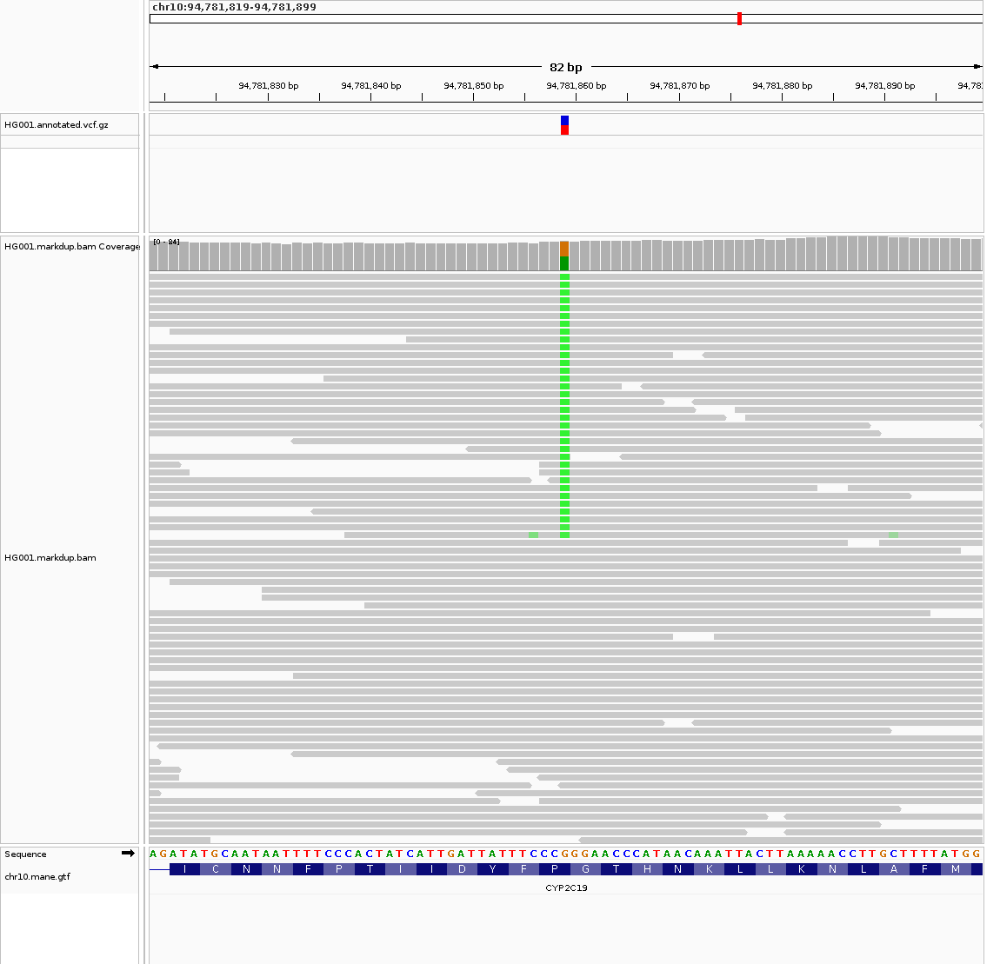
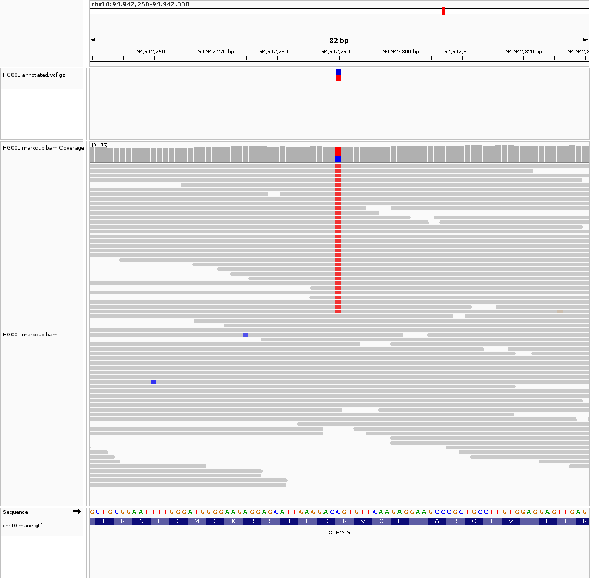
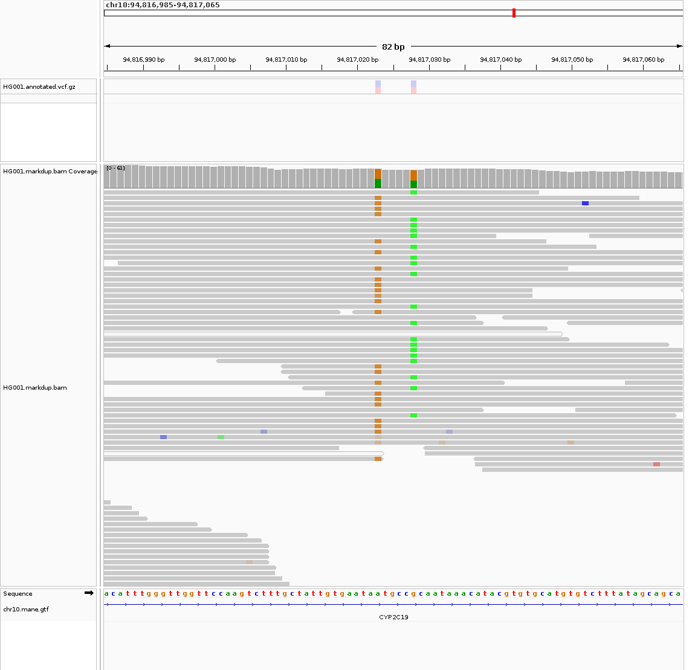
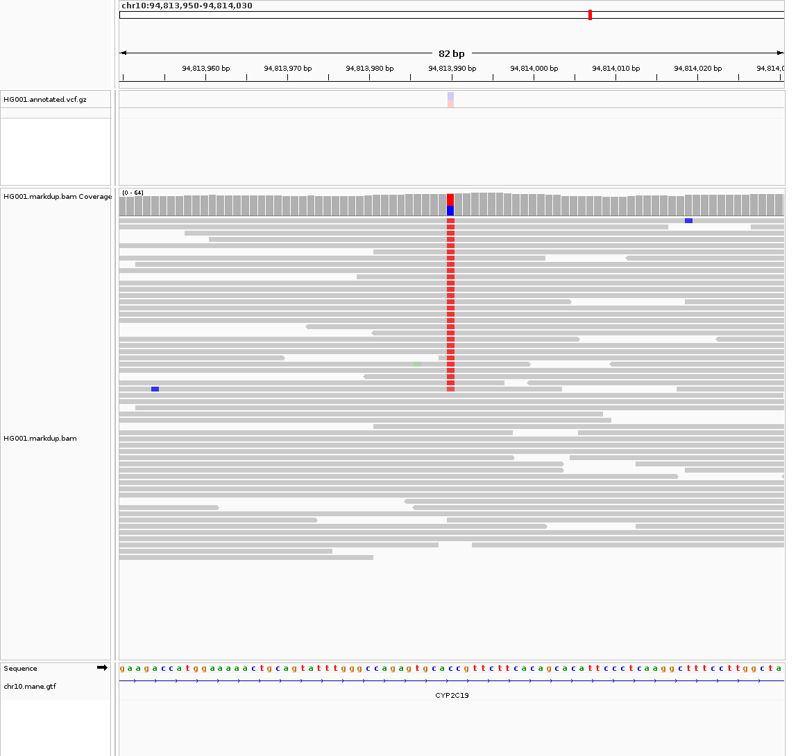

# NGS germline 변이검출 파이프라인 (Snakemake)

FASTQ에서 시작해 **QC → 정렬 → 변이검출 → 필터링 → 주석 → 정확도 검증 → 해석 리포트**까지
한 번의 명령으로 재현되는 파이프라인입니다. 공개 표준 샘플(GIAB HG001/NA12878)의 chr10 유전자 5개를
"미니 패널"로 삼아, 노트북 한 대에서 약 3분 안에 끝나도록 설계했습니다.

> 학습·포트폴리오 목적의 프로젝트이며, 여기의 결과는 임상 판독 자료가 아닙니다.

## 한눈에 보는 결과

| 항목 | 값 |
|---|---|
| 타깃 | RET, BMPR1A, PTEN, CYP2C19, CYP2C9 (각 ±2 kb, 총 504 kb) |
| 타깃 평균 depth | 58.6x (≥20x 염기 비율: 유전자별 99.7~100%) |
| 검출 변이 | 667개 → hard filter 통과 661개 |
| **SNP 정확도** (GIAB v4.2.1 대비) | precision 1.000 / recall 0.990 (TP 492, FP 0, FN 5) |
| **Indel 정확도** | precision 1.000 / recall 1.000 (TP 74, FP 0, FN 0) |
| genotype 일치율 | 100% (일치한 566개 변이 모두 het/hom까지 일치) |
| 약물유전체 결과 | CYP2C19 `*2` het, CYP2C9 `*2` het 검출 |

전체 결과물은 [`docs/example_output/`](docs/example_output/)에 있습니다
([요약 리포트](docs/example_output/HG001.report.md), [변이 표](docs/example_output/HG001.variants.tsv),
MultiQC HTML, 최종 VCF).

## 파이프라인 구조

```
공개 데이터 준비          1. QC            2. 정렬                3. 변이검출
┌────────────────┐   ┌──────────┐   ┌──────────────────┐   ┌───────────────────┐
│ hg38 chr10      │   │ FastQC   │   │ BWA-MEM2         │   │ GATK              │
│ GENCODE GTF→BED │ → │ fastp    │ → │ samtools sort    │ → │ HaplotypeCaller   │
│ HG001 FASTQ     │   │ (트리밍) │   │ MarkDuplicates   │   │ hard filter       │
└────────────────┘   └──────────┘   │ mosdepth(coverage)│   │ bcftools norm     │
                                     └──────────────────┘   └─────────┬─────────┘
                                                                      ↓
        6. 리포트                5. 정확도 검증              4. 주석
   ┌────────────────────┐   ┌─────────────────────┐   ┌────────────────────┐
   │ 변이 표 / PGx 자리 │ ← │ GIAB truth와 비교   │ ← │ SnpEff (MANE Select)│
   │ 요약 Markdown      │   │ precision / recall  │   │ ClinVar             │
   └────────────────────┘   └─────────────────────┘   └────────────────────┘
```

| 단계 | 도구 | 하는 이유 | 임상 NGS 검사에서의 대응 |
|---|---|---|---|
| 타깃 정의 | GENCODE GTF → BED | 좌표를 손으로 적지 않고 유전자 이름에서 자동 추출(빌드 혼동·오타 방지) | 패널 설계 BED |
| Read QC·트리밍 | FastQC, fastp | 어댑터·저품질 염기는 오정렬과 위양성의 원인 | run QC (Q30 등) |
| 정렬 | BWA-MEM2 | read가 게놈 어디서 왔는지 결정. read group은 GATK 필수 | 1차 분석 |
| 중복 표시 | GATK MarkDuplicates | PCR 복제본을 독립 증거로 세지 않도록 flag | 라이브러리 품질 평가 |
| Coverage | mosdepth | 20x 이상인 타깃 비율 = 검사 합격 기준 | 검사 유효성 판정 |
| 변이검출 | GATK HaplotypeCaller | local assembly 방식이라 indel 주변에서 정확 | 2차 분석 |
| 필터링 | GATK hard filter | 샘플 1개·작은 영역이라 VQSR 학습 불가 → Best Practices 권장 기준 사용 | 위양성 제거 |
| 정규화 | bcftools norm | multi-allelic 분리 + indel left-align → DB와 정확히 매칭 | 변이 표기 표준화 |
| 기능 주석 | SnpEff + MANE Select | 임상 보고서의 HGVS 표기 기준 전사체로 c./p. 표기 | 3차 분석 |
| 임상 주석 | ClinVar | 알려진 병원성·약물반응 분류 연결 | 변이 판독 근거 |
| 정확도 검증 | bcftools isec vs GIAB | 정답이 알려진 샘플로 민감도·정밀도 측정 | 검사법 밸리데이션 |

각 rule의 역할과 이유는 [`workflow/Snakefile`](workflow/Snakefile) 주석에 적어 두었습니다.

## 데이터

| 데이터 | 출처 | 비고 |
|---|---|---|
| 샘플 read | GIAB HG001 Illumina HiSeq 300x WGS BAM (NCBI FTP) | 562 GB 파일에서 패널 영역만 원격 슬라이싱(HTTP range) → 20% 서브샘플 → FASTQ로 되돌림 |
| 레퍼런스 | UCSC hg38 chr10 | 전체 게놈 인덱싱은 메모리가 부족해 한 염색체만 사용 |
| 유전자 주석 | GENCODE v46 (MANE Select) | SnpEff DB를 직접 빌드 |
| 임상 DB | ClinVar GRCh38 VCF | chr10만 원격 추출 |
| 정답 변이 | GIAB NISTv4.2.1 benchmark VCF/BED | 패널 ∩ 고신뢰 영역에서만 평가 |

모두 크레덴셜 없이 받을 수 있는 공개 데이터이고, 워크플로가 자동으로 내려받습니다.

## 실행 방법

Windows + WSL2(Ubuntu) 기준입니다. Linux에서는 2번부터 하면 됩니다.

```bash
# 1) (WSL) 코드를 리눅스 홈으로 복사 — /mnt/c 에서 직접 돌리면 I/O가 느리고 한글 경로에서 일부 도구가 깨짐
bash /mnt/c/Users/<사용자>/ngs-variant-calling-pipeline/scripts/sync_to_wsl.sh   # -> ~/ngs

# 2) 환경 구축 (micromamba + bioconda, 최초 1회 / 사전에 bzip2 필요: sudo apt install bzip2)
cd ~/ngs && bash scripts/setup_wsl.sh

# 3) 실행 (다운로드 포함 약 3~5분, RAM 8 GB면 충분)
micromamba run -n ngs snakemake --cores 8

# 4) 결과 중 작은 파일만 Windows 레포로 내보내기
bash /mnt/c/Users/<사용자>/ngs-variant-calling-pipeline/scripts/export_results.sh
```

다른 유전자로 바꾸려면 [`config/config.yaml`](config/config.yaml)의 `genes`만 고치면 됩니다(chr10 유전자 한정).
실제 사용한 도구 버전은 [`workflow/envs/environment.lock.yaml`](workflow/envs/environment.lock.yaml)에 고정해 두었습니다
(GATK 4.6.2, BWA-MEM2 2.3, samtools/bcftools 1.25, SnpEff 5.2, Snakemake 9.27).

## 결과 해석

### 1. QC — 데이터 품질 확인

- Q30 염기 비율 90.3% → 트리밍 후 92.4%, 매핑률 100%, properly paired 99.8%, 중복률 0.09%
- 타깃 평균 58.6x, 모든 유전자에서 ≥20x 비율 99.7% 이상 → germline het 변이 검출에 충분한 depth
- 중복률이 매우 낮은 것은 PCR-free WGS 라이브러리를 서브샘플링했기 때문입니다.
  hybrid capture 패널이라면 보통 훨씬 높게 나옵니다.

### 2. 정확도 — 놓친 변이 5개의 원인

위양성은 0개였고, 놓친 변이(FN)는 SNP 5개입니다. 5개 모두 **검출은 됐지만 hard filter에서 탈락**한 경우였습니다.

| 위치 | 유전자 | 탈락 사유 | QD | ALT/REF read |
|---|---|---|---|---|
| chr10:94813990 C>T | CYP2C19 | MQ 33.6 < 40 | 14.6 | 27 / 24 |
| chr10:94817023 A>G | CYP2C19 | MQ 38.9 < 40 | 16.9 | 23 / 20 |
| chr10:94817028 G>A | CYP2C19 | MQ 38.9 < 40 | 14.8 | 19 / 23 |
| chr10:94819853 C>G | CYP2C19 | MQ 38.2 < 40 | 13.6 | 16 / 20 |
| chr10:94968412 A>C | CYP2C9 | MQ 36.3 < 40 | 21.6 | 25 / 14 |

- 다섯 개 모두 QD가 높고 ALT/REF read가 균형 잡힌 전형적인 het 변이인데, **매핑 품질(MQ)만** 기준에 못 미쳤습니다.
- CYP2C19와 CYP2C9는 서로(그리고 인접한 CYP2C18, CYP2C8과) 서열이 매우 비슷한 유전자군이라,
  read가 "어느 유전자에서 왔는지" 확신하기 어려운 구간에서 MAPQ가 낮아집니다.
- 즉 `MQ < 40` 기준은 유사 유전자로 인한 위양성을 막아 주는 대신, 상동성이 높은 유전자에서는 진짜 변이를 버릴 수 있습니다.
  **필터 기준은 민감도와 정밀도의 맞교환**이고, PGx 유전자처럼 상동 영역이 많은 타깃은 영역별 기준이나
  수동 검토(IGV)가 필요하다는 것을 직접 확인했습니다.
- 이 5개에 맞춰 기준을 고치지는 않았습니다. 평가 데이터에 맞춰 튜닝하면 정확도 수치의 의미가 없어지기 때문입니다.

### 3. 약물유전체(PGx) — HG001의 CYP2C19 / CYP2C9

star allele을 정의하는 핵심 자리 5곳을 확인했습니다. 변이가 없는 자리는 depth가 충분한지(≥20x)까지 확인해
"검출 안 됨"과 "정상"을 구분했습니다.

| 유전자 | allele | rsID | 내 결과 | depth | GIAB truth |
|---|---|---|---|---|---|
| CYP2C19 | `*2` (기능 없음) | rs4244285 | **het** (REF 38 / ALT 34) | 72 | het ✔ |
| CYP2C19 | `*3` (기능 없음) | rs4986893 | 변이 없음 | 67 | 변이 없음 ✔ |
| CYP2C19 | `*17` (기능 증가) | rs12248560 | 변이 없음 | 60 | 변이 없음 ✔ |
| CYP2C9 | `*2` (기능 감소) | rs1799853 | **het** (REF 24 / ALT 32) | 56 | het ✔ |
| CYP2C9 | `*3` (기능 없음) | rs1057910 | 변이 없음 | 60 | 변이 없음 ✔ |

- **독립 검증**: 5개 자리 모두 GIAB v4.2.1 정답과 genotype이 일치했습니다. "변이 없음" 3곳은 GIAB 고신뢰 영역 안에 있고
  정답에도 변이가 없는 자리라, 단순히 "못 찾은 것"이 아니라 정답 기준으로도 hom-ref입니다. 이 대조는 리포트 단계에서 자동으로 수행됩니다.
- PGx 표준물질 프로그램인 CDC GeT-RM의 공개 자료(CYP2C19 consensus 표, CYP2C8/9/19 NGS 논문 본문)에서는
  NA12878의 star allele 합의값을 찾지 못해, star allele 수준(`*1/*2`)의 외부 대조는 하지 못했습니다.

- **CYP2C19 `*1/*2`로 추정** → CPIC 기준 intermediate metabolizer. clopidogrel(항혈소판제)은 CYP2C19가 활성형으로
  바꿔 줘야 하는 전구약물이라, 이 표현형에서는 약효가 떨어질 수 있습니다.
- **CYP2C9 `*1/*2`로 추정** → CPIC 기준 intermediate metabolizer(activity score 1.5). warfarin 등의 대사가 다소 느려집니다.
- "추정"이라고 쓴 이유: 확인한 것은 5개 자리뿐이고, 두 변이가 같은 염색체에 있는지(phasing), 유전자 결실·중복 같은
  구조 변이는 보지 않았습니다. 실제 PGx 검사는 전용 도구(PharmCAT, Aldy 등)로 전체 haplotype을 판정합니다.

### 4. 주석을 그대로 믿으면 안 되는 사례

- **CYP2C19 c.681G>A (rs4244285, `*2`)** — SnpEff는 `synonymous_variant` / impact `LOW`(p.Pro227Pro)로 분류합니다.
  아미노산은 안 바뀌지만 이 변이는 exon 5 안에 새로운 splice site를 만들어 비정상 전사체를 만들고, 결과적으로 효소 기능이 없어집니다.
  ClinVar에서도 질병 분류는 `Likely_benign`이고 약물반응 항목으로 따로 기록돼 있습니다.
  → **impact나 "benign"만으로 걸러내면 임상적으로 가장 중요한 PGx 변이를 놓칩니다.**
- **CYP2C19 c.991A>G p.Ile331Val (rs3758581, hom)** — missense이고 hom이라 눈에 띄지만 ClinVar는 Benign입니다.
  GRCh38 레퍼런스가 이 자리에서 드문 대립유전자(Ile)를 갖고 있어서, 대부분의 사람이 "변이"로 검출됩니다.
  → **레퍼런스 서열 ≠ 정상(야생형)**.
- **PTEN c.\*1459delT (rs5786797, hom, ClinVar VUS)** — 3'UTR의 T 반복 구간 indel이고 뒷받침 read가 4개뿐입니다.
  homopolymer는 시퀀싱·정렬 오류가 잦은 곳이라, 보고 전에 IGV 확인이 필요한 유형입니다.
- 그 외 BMPR1A p.Pro2Thr(Benign/Likely benign), RET intron 변이 rs2435357(Hirschsprung병 위험인자로 보고된 흔한 변이) 등은
  유전성 암 관점에서 보고 대상이 아닙니다. 세 암 유전자(PTEN, RET, BMPR1A)에서 병원성 변이는 검출되지 않았습니다.

### 5. IGV로 직접 확인

숫자만 보지 않고 read가 실제로 어떻게 쌓였는지 IGV 배치 모드로 확인했습니다
([`scripts/igv_snapshots.sh`](scripts/igv_snapshots.sh), 변이 자리의 염기 기준으로 read 정렬).

**CYP2C19 `*2` (rs4244285, chr10:94781859 G>A)** — 절반가량의 read가 A(초록)를 갖는 전형적인 het.
아래 아미노산 트랙에서 이 자리가 Pro(P) 코돈의 세 번째 염기라 아미노산이 바뀌지 않는 것(synonymous)도 보입니다.



**CYP2C9 `*2` (rs1799853, chr10:94942290 C>T)** — Arg(R) 코돈 위의 het 변이.



**MQ 필터에서 탈락한 진짜 변이 (chr10:94817023 A>G, 94817028 G>A)** — VCF 트랙에서 흐리게 표시된 것이 필터 탈락 변이입니다.
두 변이는 5 bp 떨어져 있는데 **한 read가 둘을 동시에 갖는 경우가 없습니다**(서로 다른 염색체에 있는 trans 배치).
GIAB 정답의 phasing(`0|1`과 `1|0`)과도 일치합니다. 흰색으로 보이는 read는 MAPQ 0, 즉 게놈의 다른 곳에도 똑같이 정렬될 수 있는
read이고, 이런 read가 섞여 평균 MQ를 40 아래로 끌어내렸습니다.



**MQ 필터 탈락 변이 (chr10:94813990 C>T)** — read 모양만 보면 위의 PASS 변이와 구별되지 않는 깨끗한 het입니다.



## 한계

- **read를 "이미 정렬된 BAM의 타깃 구간"에서 가져왔습니다.** 원래 다른 곳(유사 유전자 등)에 정렬됐던 read는 포함되지 않아,
  실제 WGS/캡처 데이터보다 정렬이 쉬운 조건입니다. 정확도 수치는 그만큼 낙관적일 수 있습니다.
- 레퍼런스가 chr10 하나뿐이라, 다른 염색체의 유사 서열에서 온 read를 걸러내는 효과가 없습니다.
- 정확도 비교는 위치·REF·ALT 일치(allele 단위) 방식입니다. 표준 도구인 hap.py의 haplotype 기반 비교보다 단순합니다.
- 평가 대상이 504 kb(변이 약 570개)로 작아서 수치의 통계적 불확실성이 큽니다.
- 샘플 1개라 joint genotyping, VQSR, CNV/SV 검출은 다루지 않았습니다.

## 폴더 구조

```
config/config.yaml              샘플·유전자·URL·필터 기준·PGx 자리 (코드와 설정 분리)
workflow/Snakefile              파이프라인 본체
workflow/envs/environment.yaml  conda 환경 정의 (+ lock 파일)
workflow/scripts/               make_targets.py / benchmark.py / make_report.py
scripts/                        setup_wsl.sh / sync_to_wsl.sh / export_results.sh / igv_snapshots.sh
docs/example_output/            실제 실행 결과 (리포트, 변이 표, MultiQC, 최종 VCF)
docs/igv/                       IGV 스크린샷
```

## 만들면서 겪은 문제

| 문제 | 원인 | 해결 |
|---|---|---|
| SnpEff `UnsupportedClassVersionError` | SnpEff 5.3은 Java 21 필요, GATK4는 Java 17에 고정 | SnpEff를 5.2로 고정 |
| SnpEff 공식 DB 다운로드 실패 | DB 호스트 접속 불가 | chr10 서열 + MANE Select GTF로 DB 직접 빌드 |
| FastQC `unrecognized arguments: -o` | bioconda의 최신 FastQC는 옵션 체계가 바뀜 | `--outdir` 사용 |
| 주석 없는 변이 1개(`ALT=*`) | multi-allelic 분리 후 남은 spanning deletion 표시 | 정규화 단계에서 제거 |
| Windows 경로에서 실행 문제 | `/mnt/c` I/O 지연, 한글 경로 | 코드는 Windows, 실행은 WSL 홈으로 분리(`sync_to_wsl.sh`) |
